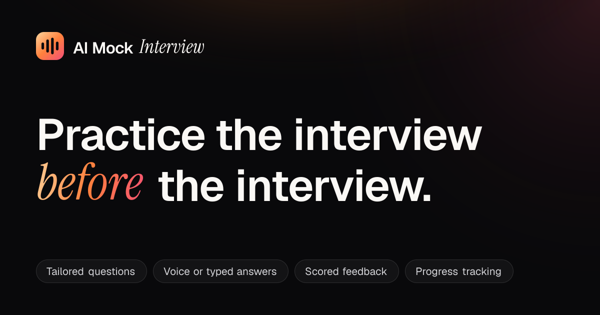
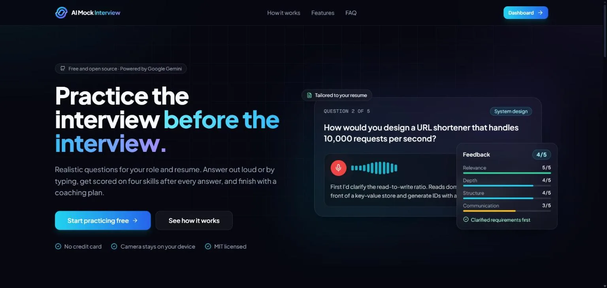
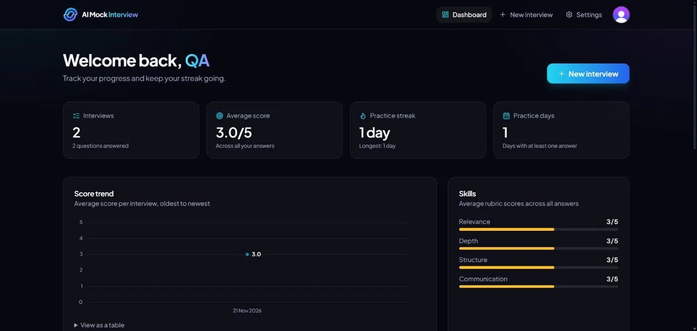
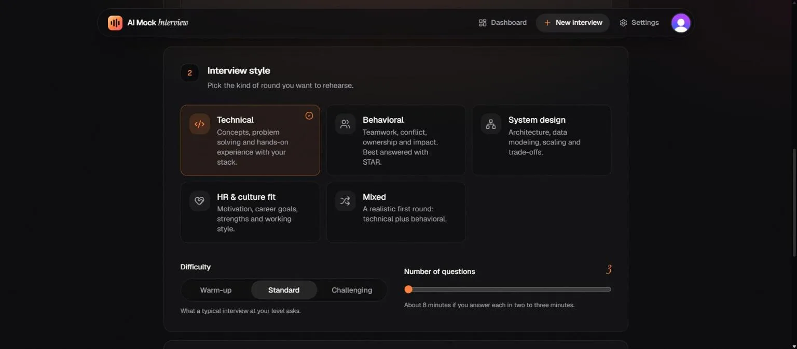
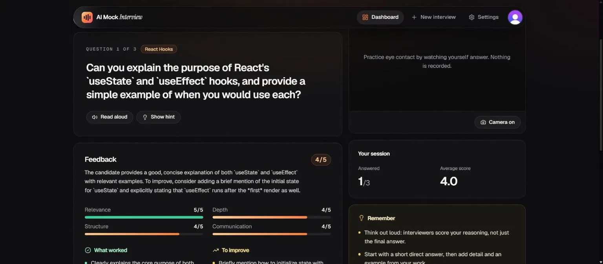
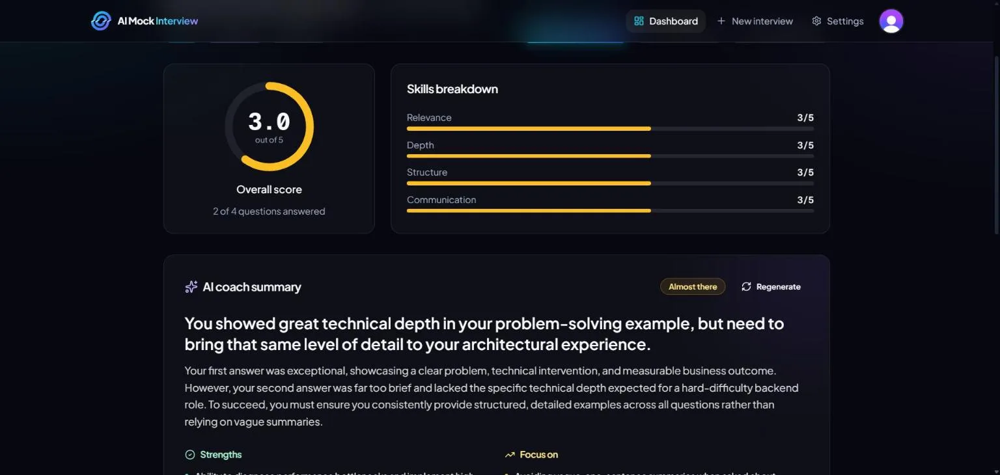
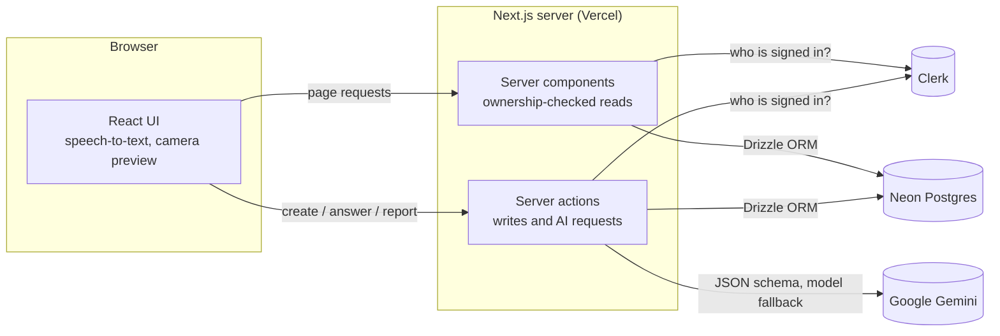

# AI Mock Interview

Practice job interviews with an AI interviewer. Get questions tailored to your role and resume, answer out loud or by typing, get scored on four skills after every answer, and finish with a coaching plan.

[](https://github.com/yuvrajtiwary-bitmesraece/AI-Mock-Interview/actions/workflows/ci.yml)
[](https://github.com/yuvrajtiwary-bitmesraece/AI-Mock-Interview/actions/workflows/verdict.yml)
[](https://github.com/yuvrajtiwary-bitmesraece/AI-Mock-Interview/actions/workflows/codeql.yml)
[](https://github.com/yuvrajtiwary-bitmesraece/AI-Mock-Interview/releases)
[](LICENSE)
[](https://nextjs.org)
[](verdict/)

**Live demo:** [ai-mock-interview-dev2.vercel.app](https://ai-mock-interview-dev2.vercel.app/)



## Contents

- [Features](#features)
- [Screenshots](#screenshots)
- [How it works](#how-it-works)
- [Tech stack](#tech-stack)
- [Getting started](#getting-started)
- [Project structure](#project-structure)
- [Security and privacy](#security-and-privacy)
- [Quality](#quality)
- [Roadmap](#roadmap)
- [Contributing](#contributing)
- [Acknowledgements](#acknowledgements)
- [License](#license)

## Features

**Realistic interviews**
- Five interview types: technical, behavioral, system design, HR & culture fit, and mixed rounds. Three difficulty levels, and 3 to 10 questions.
- **Questions tailored to your resume.** Upload a PDF and the interviewer asks about your real projects. The file goes to Gemini once and is never stored.
- Optional company, job description and tech stack, plus six one-click templates.
- A lobby with tips for the interview type, a live microphone level test and an optional camera preview.

**Answering**
- Answer **out loud** in any modern browser: Gemini transcribes the recording when you stop, accents and technical terms included, and you can edit the text before submitting. Chrome, Edge and Safari also show a live preview while you speak. Or **type** your answers.
- Speaking timer, waveform, read-aloud questions, per-question hints, and keyboard shortcuts.

**Feedback**
- **Instant rubric scoring** after every answer: relevance, depth, structure and communication (1 to 5), what worked, what to improve, and a **stronger version of your own answer**.
- **Delivery analytics** for spoken answers: speaking time, words per minute and filler words.
- An **AI coaching report** for each interview: a readiness verdict, patterns across your answers, and a three-step practice plan. Save it as a PDF, or *Practice again* with the same questions.

**Progress**
- A dashboard with your average score, practice streak, score trend chart, skill averages, a 12-week activity heatmap, and "what to do next" suggestions.

**Privacy and control**
- No audio or video is ever stored. Download all your data as JSON, or delete it, from Settings.
- Per-user daily AI limits keep the shared Gemini quota available for everyone.

## Screenshots

| Landing page | Dashboard |
| --- | --- |
|  |  |

| Interview setup | Instant feedback |
| --- | --- |
|  |  |

| Interview report |
| --- |
|  |

## How it works



1. **Set up.** The setup form calls the `createInterview` server action. It validates the form, checks the daily limit, asks Gemini for questions in JSON mode (with the resume PDF attached, if any), and saves the interview.
2. **Answer.** The browser records a voice answer and `transcribeAnswer` has Gemini transcribe it, using the question and tech stack to spell jargon correctly; the recording is never stored. After you check the text, `saveAnswer` sends only the text and the question's number. The server looks up the question and model answer itself, computes delivery metrics, asks Gemini to score the answer on the rubric, and stores the result.
3. **Review.** Pages are server components that load only your data. The report reuses a cached AI summary until your answers change.

The browser never talks to the database or Gemini directly and never sees their credentials. During an interview it only receives the questions; model answers stay on the server until the report.

**Resilient AI calls.** Requests go through a chain of Gemini models (`GEMINI_MODELS`). If one is overloaded, rate-limited, retired or slow, the next one is tried, within a 50-second budget. Candidate text is fenced in tags that the model is told to treat as data, which blunts prompt injection.

## Tech stack

| Layer | Technology |
| --- | --- |
| Framework | [Next.js 16](https://nextjs.org) (App Router, server components and actions, Turbopack), React 19 |
| UI | Tailwind CSS 3 with design tokens, [shadcn/ui](https://ui.shadcn.com) and Radix UI, Lucide icons, Sonner toasts |
| Auth | [Clerk](https://clerk.com) |
| Database | [Neon](https://neon.tech) serverless Postgres, [Drizzle ORM](https://orm.drizzle.team) with versioned migrations |
| AI | Google Gemini via [`@google/genai`](https://www.npmjs.com/package/@google/genai), with a model fallback chain |
| Speech | Gemini transcription of recorded answers (MediaRecorder), Web Speech API for the live preview and read-aloud, Web Audio API for the microphone test |
| Code judge (in progress) | [Verdict](verdict/): Go 1.27, one locked-down Docker container per submission, rlimits applied through a re-exec shim, HMAC-signed results |
| Hosting and analytics | Vercel, Vercel Web Analytics and Speed Insights (cookie-free) |
| Quality | ESLint, Node's built-in test runner (81 tests), GitHub Actions, CodeQL, dependency review, Dependabot |

## Getting started

### Prerequisites

- Node.js 20.9 or newer (`.nvmrc` pins 24)
- Free accounts for [Clerk](https://dashboard.clerk.com), [Neon](https://console.neon.tech) and [Google AI Studio](https://aistudio.google.com/apikey) (Gemini API key)
- Chrome or Edge to answer out loud. Other browsers can type their answers.

### Setup

```bash
# 1. Clone and install
git clone https://github.com/yuvrajtiwary-bitmesraece/AI-Mock-Interview.git
cd AI-Mock-Interview
npm install

# 2. Configure environment variables
cp .env.example .env.local        # Windows: copy .env.example .env.local
#    ...then fill in the values (see below)

# 3. Create the database tables
npm run db:migrate

# 4. Start the dev server
npm run dev
```

Open [http://localhost:3000](http://localhost:3000).

### Deploy your own

[](https://vercel.com/new/clone?repository-url=https%3A%2F%2Fgithub.com%2Fyuvrajtiwary-bitmesraece%2FAI-Mock-Interview&env=NEXT_PUBLIC_CLERK_PUBLISHABLE_KEY,CLERK_SECRET_KEY,DATABASE_URL,GEMINI_API_KEY&envDescription=Clerk%20keys%2C%20a%20Neon%20Postgres%20URL%20and%20a%20Gemini%20API%20key&envLink=https%3A%2F%2Fgithub.com%2Fyuvrajtiwary-bitmesraece%2FAI-Mock-Interview%2Fblob%2Fmain%2F.env.example)

Run `npm run db:migrate` against your database once before the first deploy.

### Environment variables

| Variable | Required | Description |
| --- | --- | --- |
| `NEXT_PUBLIC_CLERK_PUBLISHABLE_KEY` | Yes | Clerk publishable key (safe to expose) |
| `CLERK_SECRET_KEY` | Yes | Clerk secret key |
| `NEXT_PUBLIC_CLERK_SIGN_IN_URL` | Yes | `/sign-in` |
| `NEXT_PUBLIC_CLERK_SIGN_UP_URL` | Yes | `/sign-up` |
| `DATABASE_URL` | Yes | Neon Postgres connection string. **Server-only.** |
| `GEMINI_API_KEY` | Yes | Google Gemini API key. **Server-only.** |
| `GEMINI_MODELS` | No | Comma-separated Gemini models to try in order (default `gemini-3.5-flash-lite,gemini-2.5-flash,gemini-3.1-flash-lite`) |
| `INTERVIEW_QUESTION_COUNT` | No | Default number of questions in the setup form, 3–10 (default `5`) |
| `GEMINI_TRANSCRIBE_MODELS` | No | Gemini models for transcribing voice answers (default `gemini-3.5-transcribe,gemini-3.5-flash-lite,gemini-2.5-flash`) |
| `AI_DAILY_LIMIT_INTERVIEWS`, `AI_DAILY_LIMIT_ANSWERS`, `AI_DAILY_LIMIT_REPORTS`, `AI_DAILY_LIMIT_TRANSCRIPTIONS` | No | Per-user daily AI limits (defaults 10, 100, 30, 300; `0` turns a limit off) |
| `NEXT_PUBLIC_SITE_URL` | No | Public URL, only needed with a custom domain |

> [!WARNING]
> Never put a secret in a variable that starts with `NEXT_PUBLIC_`. Next.js copies those values into the JavaScript sent to every visitor.

### Scripts

| Command | What it does |
| --- | --- |
| `npm run dev` | Start the development server |
| `npm run build` / `npm start` | Production build / run it |
| `npm run lint` | ESLint |
| `npm test` | Unit tests (`node:test`) |
| `npm run db:migrate` | Apply the SQL migrations in `drizzle/` |
| `npm run db:generate` | Create a migration after changing `utils/schema.js` |
| `npm run db:push` | Sync the schema without a migration (quick local experiments only) |
| `npm run db:studio` | Browse the database in Drizzle Studio |
| `node scripts/generate-icons.mjs` | Regenerate the favicon and app icons from `public/logo.svg` |

## Project structure

```
actions/interview.js     Server actions: create, answer, report, retake, delete, export (auth, ownership, limits)
app/
  page.js                Landing page (static)
  (auth)/                Sign-in and sign-up
  (legal)/               Privacy policy and terms
  dashboard/
    page.jsx             Progress dashboard
    new/                 Interview setup form
    settings/            Usage, data export and deletion
    interview/[interviewId]/
      page.jsx           Lobby: tips and device check
      start/             Interview room: questions, answers, instant feedback
      feedback/          Interview report and AI coach summary
  opengraph-image.jsx    Generated social card; robots.js, sitemap.js, manifest.js for SEO and PWA
components/              UI kit (shadcn/ui), brand, interview widgets and site chrome
drizzle/                 Versioned SQL migrations
utils/
  gemini.js              Gemini client with model fallback and timeouts (server-only)
  queries.js             Ownership-checked reads (server-only)
  auth.js, usage.js, db.js  Viewer, daily limits, database client (server-only)
  prompts.js             Prompts and response schemas, with prompt-injection fencing
  interview-options.js   Interview types, difficulty, templates and form validation
  report.js, progress.js, speech.js  Scoring, reports, dashboard stats, delivery metrics
  __tests__/             Unit tests
proxy.js                 Requires sign-in for /dashboard (Next.js 16 "proxy")
verdict/                 Verdict, the sandboxed code judge in Go (in progress; see verdict/README.md)
```

### Database

| Table | Purpose |
| --- | --- |
| `mock_interview` | One row per interview: settings, generated questions (JSON), owner (`userId`), cached AI report |
| `userAnswer` | One row per answered question: answer text, rubric analysis, delivery metrics, feedback |
| `usage_counter` | AI requests per user per day, for the daily limits |

## Security and privacy

- Database and Gemini clients import [`server-only`](https://www.npmjs.com/package/server-only), so the build fails if browser code ever imports them.
- Every read and write checks the signed-in user. Interviews are owned by the Clerk user ID. Older interviews are matched by **verified** email only, so adding someone else's address to an account can't claim their data.
- Reads happen in server components, so they aren't exposed as endpoints. Server actions validate all input and never throw raw errors to the browser.
- Candidate text in prompts is fenced and treated as data, and an answer that asks for a better score earns nothing for it.
- Security headers on every response (clickjacking protection, `nosniff`, HSTS, a strict referrer policy, and a permissions policy that only allows the camera and microphone).
- See the [privacy policy](https://ai-mock-interview-dev2.vercel.app/privacy) for what is stored. To report a vulnerability, see [SECURITY.md](SECURITY.md).

## Quality

- **91 unit tests** for prompts and injection fencing, validation, scoring, reports, streaks, delivery metrics, retries and resume checks (`npm test`).
- CI lints, tests and builds every pull request. CodeQL scans the code and workflows, dependency review blocks vulnerable new dependencies, and Dependabot keeps packages current.
- **Verdict**, the Go code judge, has its own CI on x64 and arm64: unit tests under the race detector, a fuzzed output checker, and integration tests that judge real C++ programs in Docker sandboxes.
- Every change goes through a pull request and is recorded in [CHANGELOG.md](CHANGELOG.md).

## Roadmap

Ideas for future versions. [Contributions are welcome](CONTRIBUTING.md):

- Follow-up questions that react to your answer, like a real interviewer
- A coding round with an in-browser editor, judged by [Verdict](verdict/) (in progress)
- Pro and Campus plans: coding rounds, AI review of your code, core CS packs and a dashboard for placement cells. Nothing is for sale yet; see [docs/PLANS.md](docs/PLANS.md)
- Interviews in more languages
- End-to-end tests with Playwright
- Shareable report links

## Contributing

Contributions are welcome: bug reports, feature ideas, documentation fixes and pull requests.

- Read [CONTRIBUTING.md](CONTRIBUTING.md) for the development setup, branch naming, database migrations and commit style.
- Look for issues labeled [`good first issue`](https://github.com/yuvrajtiwary-bitmesraece/AI-Mock-Interview/labels/good%20first%20issue).
- Please follow the [Code of Conduct](CODE_OF_CONDUCT.md), and report security problems privately as described in [SECURITY.md](SECURITY.md).

This project follows [Semantic Versioning](https://semver.org). Each version is published on the [Releases](https://github.com/yuvrajtiwary-bitmesraece/AI-Mock-Interview/releases) page.

## Acknowledgements

- [Google Gemini](https://ai.google.dev), [Clerk](https://clerk.com), [Neon](https://neon.tech), [Drizzle ORM](https://orm.drizzle.team), [shadcn/ui](https://ui.shadcn.com) and the [Next.js](https://nextjs.org) team.
- [Plus Jakarta Sans](https://fonts.google.com/specimen/Plus+Jakarta+Sans) and [Geist Mono](https://vercel.com/font), both under the SIL Open Font License.

## Contact

**Yuvraj Tiwary**

- LinkedIn: [yuvraj-tiwary](https://www.linkedin.com/in/yuvraj-tiwary-426279254/)
- Email: yuvrajtiwary699@gmail.com

## License

Released under the [MIT License](LICENSE). You are free to use, modify and distribute this project, including commercially, as long as you keep the copyright and license notice.
