# AI Mock Interview

Practice job interviews with an AI interviewer. Describe the role you're preparing for, answer AI-generated questions out loud, and get a rating plus written feedback on every answer.

[](https://github.com/yuvrajtiwary-bitmesraece/AI-Mock-Interview/actions/workflows/ci.yml)
[](https://github.com/yuvrajtiwary-bitmesraece/AI-Mock-Interview/releases)
[](https://github.com/yuvrajtiwary-bitmesraece/AI-Mock-Interview/actions/workflows/codeql.yml)
[](LICENSE)
[](https://nextjs.org)

**Live demo:** [ai-mock-interview-dev2.vercel.app](https://ai-mock-interview-dev2.vercel.app/)

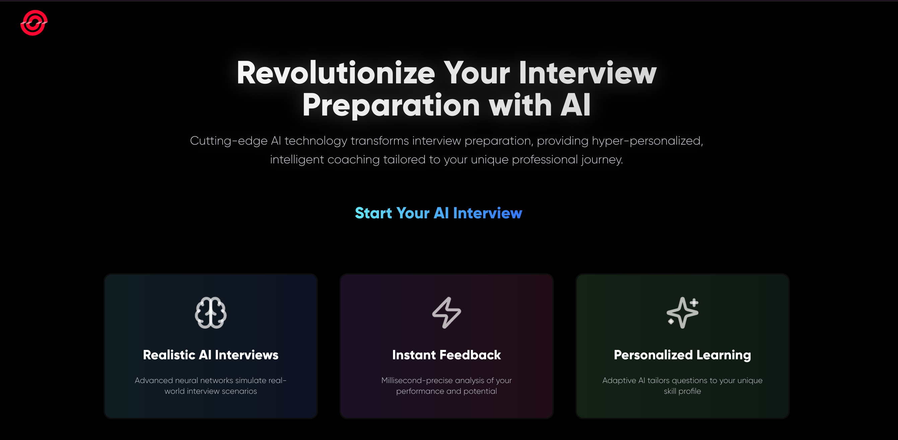

## Contents

- [Features](#features)
- [How it works](#how-it-works)
- [Tech stack](#tech-stack)
- [Getting started](#getting-started)
- [Project structure](#project-structure)
- [Security](#security)
- [Versioning and releases](#versioning-and-releases)
- [Screenshots](#screenshots)
- [Roadmap](#roadmap)
- [Contributing](#contributing)
- [Acknowledgements](#acknowledgements)
- [License](#license)

## Features

- **Tailored questions.** Enter a job title, description, tech stack and years of experience. Gemini generates interview questions with model answers, matched to your experience level.
- **Answer by voice.** Your answer is transcribed live in the browser with the Web Speech API. You can edit the transcript before submitting it.
- **AI feedback on every answer.** Each answer gets a 1–5 rating and 3–5 sentences on how to improve. The feedback page shows your overall score and lets you compare your answer with the model answer.
- **Interview history.** The dashboard lists your past interviews. You can retake, review or permanently delete any of them.
- **Accounts with Clerk.** Sign up and sign in. Each user can only see and change their own interviews.
- **No audio or video stored.** The webcam is only a local preview. Only the text of your answers is saved.

## How it works

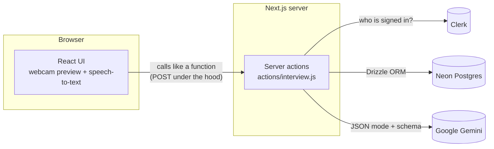

1. **Create an interview.** The form calls the `createInterview` server action. The server asks Gemini for questions in JSON mode with a response schema, checks the result, and saves it to Postgres.
2. **Answer questions.** The browser turns your speech into text. When you submit, `saveAnswer` sends only the answer text and the question's index. The server looks up the question itself, asks Gemini to rate the answer, and stores the result. Re-recording replaces your earlier answer.
3. **Review feedback.** The feedback page is a server component. It loads your answers, keeps the latest one per question, and averages the ratings.

The browser never talks to the database or Gemini directly, and never receives their credentials.

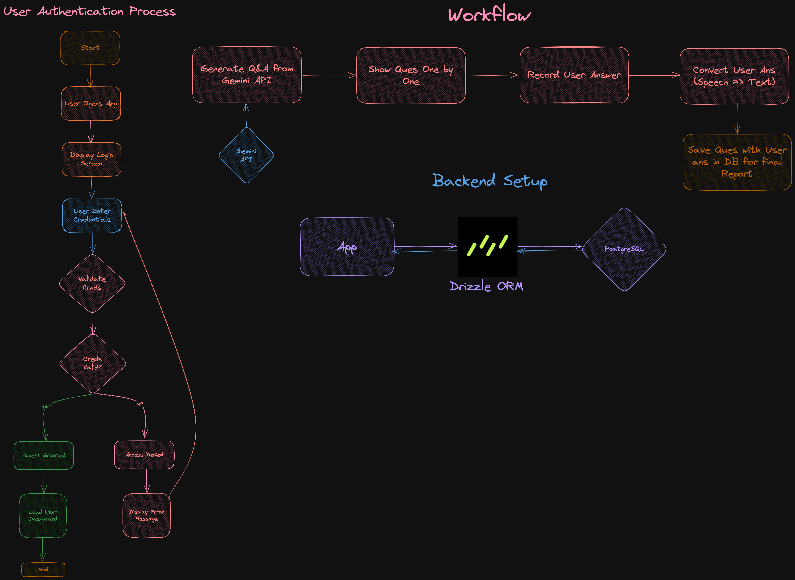

## Tech stack

| Layer | Technology |
| --- | --- |
| Framework | [Next.js 15](https://nextjs.org) (App Router, server actions), React 19 |
| UI | Tailwind CSS 3, [shadcn/ui](https://ui.shadcn.com) (Radix UI), Framer Motion, Lucide icons, Sonner toasts |
| Auth | [Clerk](https://clerk.com) |
| Database | [Neon](https://neon.tech) serverless Postgres with [Drizzle ORM](https://orm.drizzle.team) |
| AI | Google Gemini 2.5 Flash via `@google/generative-ai` |
| Speech | Web Speech API (`SpeechRecognition` for answers, `speechSynthesis` to read questions aloud) |
| Tooling | ESLint, Node's built-in test runner, GitHub Actions, Dependabot |
| Hosting | Vercel |

## Getting started

### Prerequisites

- Node.js 20 or newer (`.nvmrc` pins 24)
- A [Clerk](https://dashboard.clerk.com) application
- A [Neon](https://console.neon.tech) Postgres database
- A [Gemini API key](https://aistudio.google.com/apikey)
- Chrome or Edge for voice answers. Safari support is partial, and Firefox doesn't support speech recognition.

### Setup

```bash
# 1. Clone and install
git clone https://github.com/yuvrajtiwary-bitmesraece/AI-Mock-Interview.git
cd AI-Mock-Interview
npm install

# 2. Configure environment variables
cp .env.example .env.local        # Windows: copy .env.example .env.local
#    ...then fill in the values (see below)

# 3. Create the database tables
npm run db:push

# 4. Start the dev server
npm run dev
```

Open [http://localhost:3000](http://localhost:3000).

### Environment variables

| Variable | Required | Description |
| --- | --- | --- |
| `NEXT_PUBLIC_CLERK_PUBLISHABLE_KEY` | Yes | Clerk publishable key (safe to expose) |
| `CLERK_SECRET_KEY` | Yes | Clerk secret key |
| `NEXT_PUBLIC_CLERK_SIGN_IN_URL` | Yes | `/sign-in` |
| `NEXT_PUBLIC_CLERK_SIGN_UP_URL` | Yes | `/sign-up` |
| `DATABASE_URL` | Yes | Neon Postgres connection string. **Server-only.** |
| `GEMINI_API_KEY` | Yes | Google Gemini API key. **Server-only.** |
| `INTERVIEW_QUESTION_COUNT` | No | Questions per interview, 1–10 (default `5`) |

> [!WARNING]
> Never put a secret in a variable that starts with `NEXT_PUBLIC_`. Next.js copies those values into the JavaScript sent to every visitor.

### Scripts

| Command | What it does |
| --- | --- |
| `npm run dev` | Start the development server |
| `npm run build` | Production build |
| `npm start` | Run the production build |
| `npm run lint` | ESLint |
| `npm test` | Unit tests (`node:test`) |
| `npm run db:push` | Create or update database tables from `utils/schema.js` |
| `npm run db:studio` | Browse the database in Drizzle Studio |

## Project structure

```
actions/
  interview.js          Server actions: create, read, answer, delete (auth + ownership checks)
app/
  (auth)/               Clerk sign-in and sign-up pages
  dashboard/
    _components/        Header, new-interview dialog, interview list and cards
    interview/[interviewId]/
      page.jsx          Pre-interview setup (webcam check)
      start/            Question panel + answer recorder
      feedback/         Ratings and feedback (server component)
  layout.js             Root layout, Clerk provider, toasts
  page.js               Landing page
components/ui/          shadcn/ui components and footer
utils/
  db.js                 Drizzle client (server-only)
  GeminiAiModel.js      Gemini client (server-only)
  schema.js             Database tables
  questions.js          Parses stored questions (shared)
  rating.js             Normalizes ratings (shared)
  __tests__/            Unit tests
middleware.js           Requires sign-in for /dashboard
```

### Database

| Table | Purpose |
| --- | --- |
| `mock_interview` | One row per interview: job details, generated questions (JSON), owner email, `mockId` (UUID used in URLs) |
| `userAnswer` | One row per answered question: transcript, model answer, AI rating and feedback |

## Security

- Database and Gemini clients import [`server-only`](https://www.npmjs.com/package/server-only), so the build fails if they're ever imported into browser code.
- Every server action looks up the signed-in user and only reads or changes that user's interviews.
- The server looks up questions and model answers itself, so the browser can't tamper with them.
- Middleware requires sign-in for every `/dashboard` route.

To report a vulnerability, see [SECURITY.md](SECURITY.md).

## Versioning and releases

This project follows [Semantic Versioning](https://semver.org). Every notable change is recorded in [CHANGELOG.md](CHANGELOG.md), and each version is published on the [Releases](https://github.com/yuvrajtiwary-bitmesraece/AI-Mock-Interview/releases) page. See [CONTRIBUTING.md](CONTRIBUTING.md) for the branch, pull request and release workflow.

## Screenshots

| Sign in | Dashboard |
| --- | --- |
| 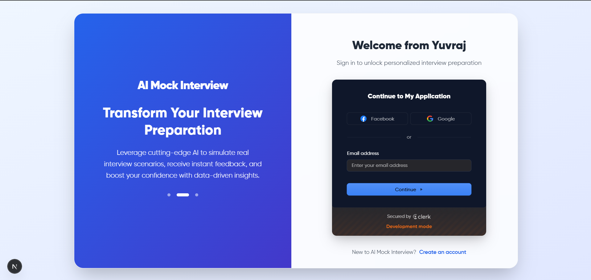 | 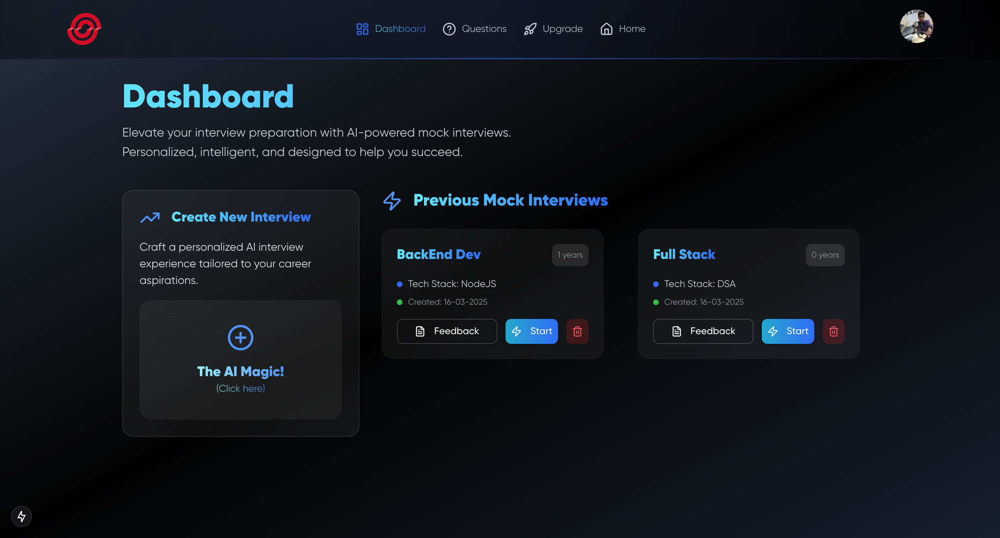 |

| Interview details | Generated questions |
| --- | --- |
| 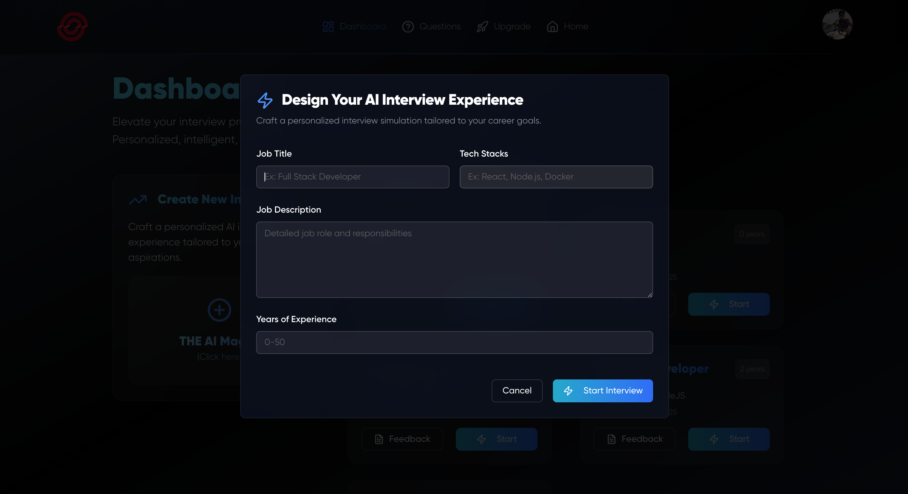 | 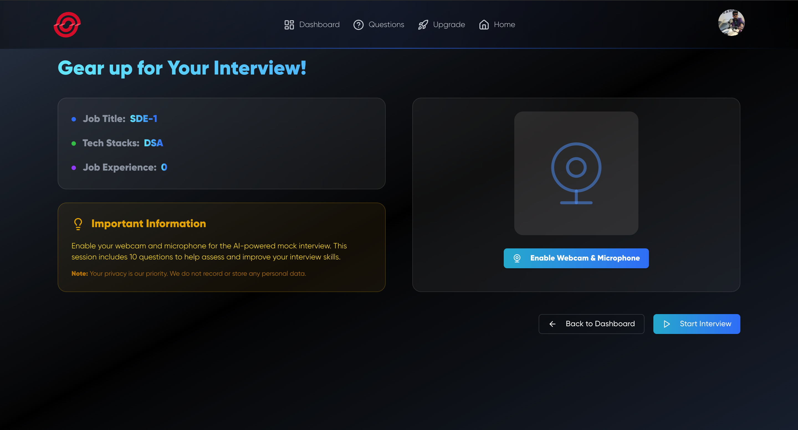 |

| Question panel | Recording an answer |
| --- | --- |
| 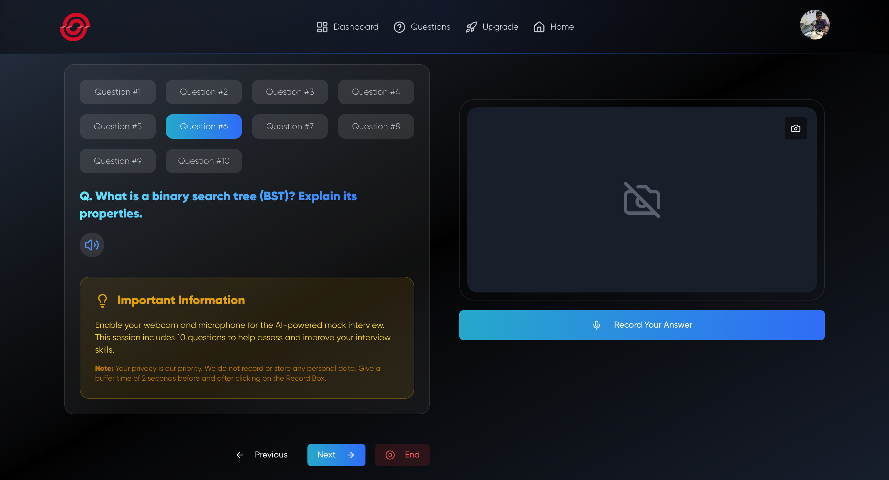 | 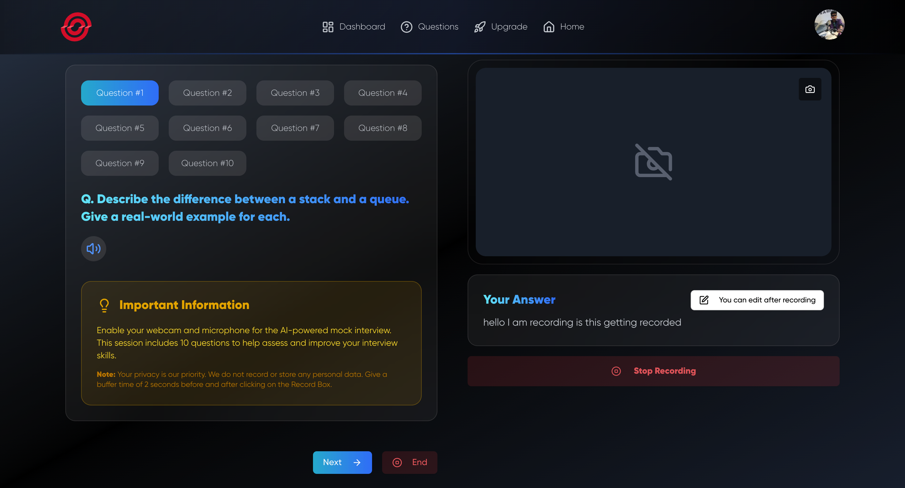 |

| Editing a transcript | Deleting an interview |
| --- | --- |
| 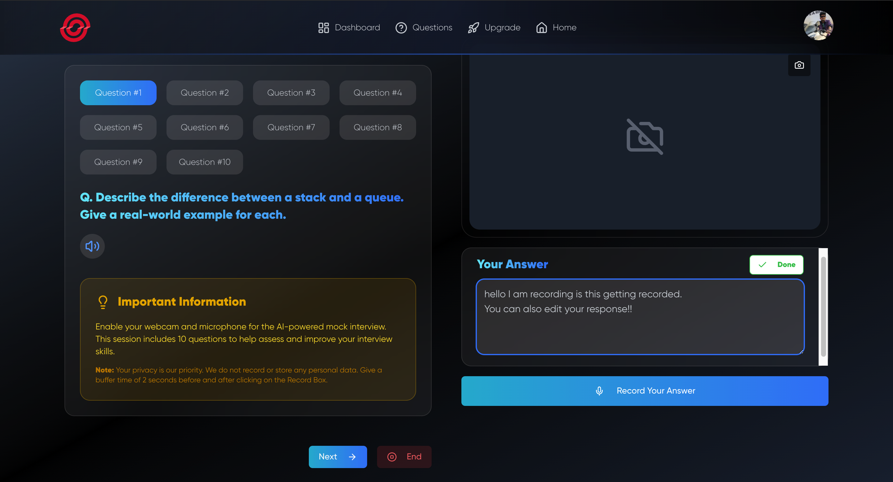 | 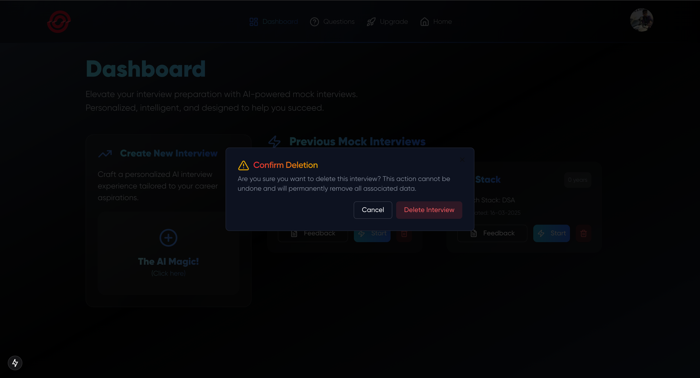 |

| Feedback | Ratings | Answer details |
| --- | --- | --- |
| 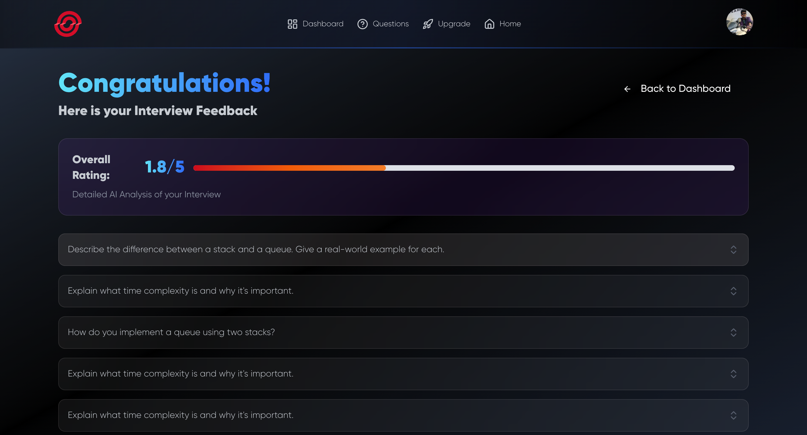 | 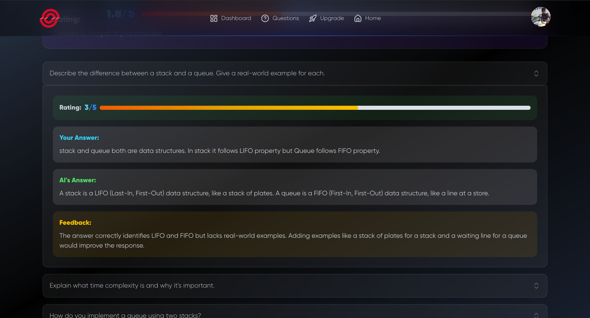 | 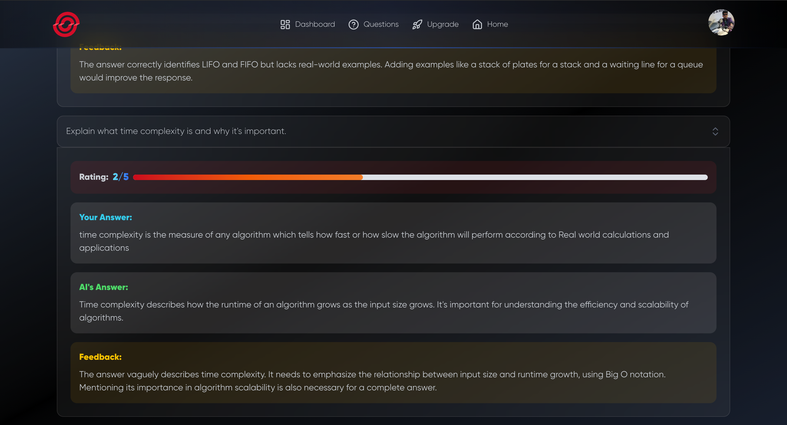 |

## Roadmap

- Move page data loading into React Server Components
- Store the Clerk user ID instead of the email as the owner key
- Migrate to the `@google/genai` SDK and Next.js 16
- Interview types beyond technical roles (HR, behavioral, system design)
- Progress analytics across interviews

## Contributing

Contributions are welcome: bug reports, feature ideas, documentation fixes and pull requests.

- Read [CONTRIBUTING.md](CONTRIBUTING.md) for the development setup, branch naming and commit style.
- Look for issues labeled `good first issue` if you are new to the codebase.
- Please follow the [Code of Conduct](CODE_OF_CONDUCT.md).
- Report security problems privately, as described in [SECURITY.md](SECURITY.md).

## Acknowledgements

- Originally based on [AI-Mock-Interview](https://github.com/Adi1816/AI-Mock-Interview) by Aditya Srivastava.
- [Google Gemini](https://ai.google.dev), [Clerk](https://clerk.com), [Neon](https://neon.tech), [Drizzle ORM](https://orm.drizzle.team), [shadcn/ui](https://ui.shadcn.com) and the [Next.js](https://nextjs.org) team.
- [Plus Jakarta Sans](https://fonts.google.com/specimen/Plus+Jakarta+Sans) and [Geist Mono](https://vercel.com/font), both under the SIL Open Font License.

## Contact

**Yuvraj Tiwary**

- LinkedIn: [yuvraj-tiwary](https://www.linkedin.com/in/yuvraj-tiwary-426279254/)
- Email: yuvrajtiwary699@gmail.com

## License

Released under the [MIT License](LICENSE). You are free to use, modify and distribute this project, including commercially, as long as you keep the copyright and license notice.

Copyright © 2025 Aditya Srivastava (original project) and © 2026 Yuvraj Tiwary.
