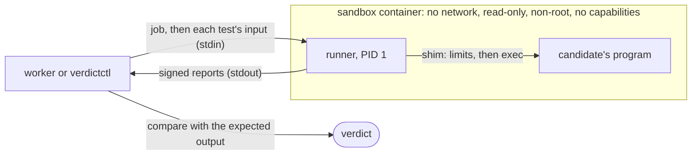

# Verdict

Verdict is a sandboxed code judge written in Go. It compiles untrusted code, runs it against test cases inside locked-down Docker containers and returns a verdict: Accepted, Wrong Answer, Time Limit Exceeded and so on. It will power the coding round of [AI Mock Interview](../README.md).

**Status: Stage A of 5.** The runner, the C++17 sandbox and the `verdictctl` development CLI work end to end, with one problem in the bank. Next come the HTTP API, the Redis queue and the worker (Stage B), then Python, Java and the full problem bank (Stage C). The [spec](docs/SPEC.md) describes every stage, and the [design notes](docs/DESIGN.md) explain the decisions behind the code.

## How a submission is judged



1. The worker starts one container per submission. It has no network, a read-only root filesystem and a 64 MB tmpfs as the only writable, executable place. It runs as a non-root user with every Linux capability dropped and `no-new-privileges`, under a memory limit without swap, a limit of 128 processes and one CPU. Nothing from the host is mounted, and the environment is empty.
2. The worker writes the job to the runner's stdin: the source code, the compile and run commands, the limits and a random per-job key, followed by the input of every test.
3. The runner makes itself non-dumpable, so the program cannot read the key through `/proc`. It then compiles the source and runs each test. Every program starts through a re-exec shim that sets CPU-time, file-size and stack limits before the program's first instruction. Each test's input is streamed straight into the program's stdin, so a program only ever sees the input of the test it is running.
4. The runner kills the program's whole process group at the wall-clock limit, keeps at most 1 MB of stdout and 4 KB of stderr, and measures CPU time and peak memory. It signs every report line with the job key.
5. The worker checks every signature and compares each output with the expected output, which never enters the container. A forged or missing report gives an internal error (IE), which is retried once and never counts as Accepted.

## Try it

You need [Go 1.27](https://go.dev/dl/) and Docker. Docker Desktop works on Windows and macOS.

```sh
cd verdict
docker build -f images/cpp/Dockerfile -t verdict-cpp:dev .

go run ./cmd/verdictctl problems
go run ./cmd/verdictctl submit -problem budget-windows problems/budget-windows/solutions/main.cpp
```

`-mode run`, the default, runs only the sample tests and shows the input, expected and actual output of each one that fails. `-mode submit` also runs the hidden tests, whose data is never shown. `-json` prints the result in the shape the API will return.

A solution that keeps its count in an `int` passes every sample:

```
$ go run ./cmd/verdictctl submit -problem budget-windows internal/judge/testdata/cpp/overflow.cpp
Budget Windows | C++17 | run

Compiled in 3.4 s

  #  KIND    VERDICT  CPU    WALL   MEMORY
  1  sample  AC       16 ms  17 ms  3.6 MB
  2  sample  AC       6 ms   15 ms  3.8 MB
  3  sample  AC       8 ms   6 ms   3.9 MB

Verdict: AC (Accepted), 3/3 tests passed, 6.0 s
```

The hidden tests catch it. Only the largest answer, 20,000,100,000, does not fit in 32 bits:

```
$ go run ./cmd/verdictctl submit -problem budget-windows -mode submit internal/judge/testdata/cpp/overflow.cpp
  ...
  17  hidden  AC       40 ms   63 ms   4.0 MB
  18  hidden  WA       104 ms  126 ms  4.0 MB
  19  hidden  AC       328 ms  382 ms  12.3 MB
  20  hidden  AC       73 ms   92 ms   4.0 MB

Verdict: WA (Wrong Answer), 19/20 tests passed, 13.4 s
```

`verdictctl` exits with status 0 when the verdict is the expected one (`-expect`, AC by default), 1 when it is not, and 2 when the file could not be judged.

## Tests

```sh
go test ./...                                         # unit tests; the runner's only run on Linux
go test -race ./...                                   # on Linux, as CI does
go test -run '^$' -fuzz FuzzCheck ./internal/judge/   # fuzz the output checker
go test -tags integration -count=1 ./internal/judge/  # real programs in Docker; build the image first
```

The integration suite judges the reference solution (AC on all 20 tests) and the brute force (TLE on the largest tests). It also judges programs that answer wrongly, overflow an `int`, loop forever, write through a null pointer, divide by zero, throw, exit with an error, fail to compile and print forever. Afterwards it checks that no sandbox container is left behind. CI runs all of this on x64 and arm64 ([workflow](../.github/workflows/verdict.yml)).

## Layout

```
cmd/runner          runs inside the sandbox as PID 1 (Linux only)
cmd/verdictctl      the development CLI
internal/protocol   the job and report formats, HMAC signing
internal/runner     compiling and running tests under limits
internal/sandbox    the container: docker flags and cleanup
internal/judge      limits, the output checker, verdicts, the IE retry
internal/problems   loads the problem bank
images/cpp          the C++ sandbox image: g++ and the runner
problems/           the problem bank
docs/SPEC.md        the spec, the source of truth
docs/DESIGN.md      decisions, and where the code differs from the spec
```

## Adding a problem

Each problem is a directory in `problems/` named after its slug, laid out as in [section 7 of the spec](docs/SPEC.md#7-problem-bank). Write the statement yourself, then write a generator in `gen/` that produces the sample and hidden tests deterministically, and commit its output. CI reruns every generator and fails if the committed tests differ. The bank's rules (at least 15 hidden tests, a reference solution, a brute force and a generator) are checked by `TestBank` in `internal/problems`. Use `verdictctl` to check that the reference solution gets AC and that the brute force gets TLE.
